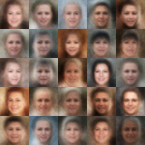
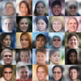
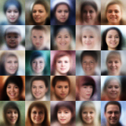

<h1 align="center">VAE</h1>

 In this project I coded and successfully trained a <strong>Variational Autoencoder (VAE)</strong> using a <a href="https://github.com/Peppooo/nn">library</a> I personally coded and still plan to improve.   Since my library currently only has fully connected layers, I decided to work with the <a href="https://github.com/nvlabs/ffhq-dataset">FFHQ dataset</a>, with images resized down to <strong>32×32</strong>. 

<h2>Samples</h2>

 Here are some samples from the trained models included in this repository: 

 The first model was trained on a CPU. 

  

 <i>Samples generated by the model_ffhq32r.bin model, trained on CPU</i> 

 This 32×32 RGB model has <strong>7.5M learnable parameters</strong>. 

 Two newer models were trained on a GPU using later updates to the cuNN library: 

  

 <i>Samples generated by resdense-ffhq32-small.bin — loss: 0.0974194</i> 

<strong>Small model architecture</strong> (fully connected residual VAE):

<ul>
  <li>Input: each 32×32 RGB image is flattened into 3,072 values.</li>
  <li>Encoder: projects to 512 features, then applies two residual MLP blocks. Each expands 512→1,024 with GeLU and dropout, projects back to 512, and adds a skip connection scaled by 0.1. The encoder outputs 256 values: 128 latent means and 128 log-variances.</li>
  <li>Latent and decoder: samples a 128-value latent vector, projects it to 512 features, applies two more 512-wide residual MLP blocks with skip connections scaled by 0.1, then projects to 3,072 values. A sigmoid maps the output to RGB values in [0, 1].</li>
  <li>Dropout: encoder input 0.3, encoder residual blocks 0.3, and between encoder blocks 0.4 then 0.3; decoder residual blocks use no dropout.</li>
</ul>

  

 <i>Samples generated by resdense-ffhq32-large.bin — loss: 0.0773704</i> 

<strong>Large model architecture</strong> (fully connected residual VAE):

<ul>
  <li>Input: each 32×32 RGB image is flattened into 3,072 values.</li>
  <li>Encoder: projects to 1,024 features, then applies three residual MLP blocks. Each expands 1,024→2,048 with GeLU and dropout, projects back to 1,024, and adds a skip connection scaled by 0.1 in the first block and 0.05 in the next two. The encoder outputs 256 values: 128 latent means and 128 log-variances.</li>
  <li>Latent and decoder: samples a 128-value latent vector, projects it to 1,024 features, applies three more 1,024-wide residual MLP blocks (skip scales 0.1, 0.05, 0.05), then projects to 3,072 values. A sigmoid maps the output to RGB values in [0, 1].</li>
  <li>Dropout: encoder input, residual blocks, and transitions between encoder blocks use 0.1; decoder residual blocks use no dropout.</li>
</ul>
